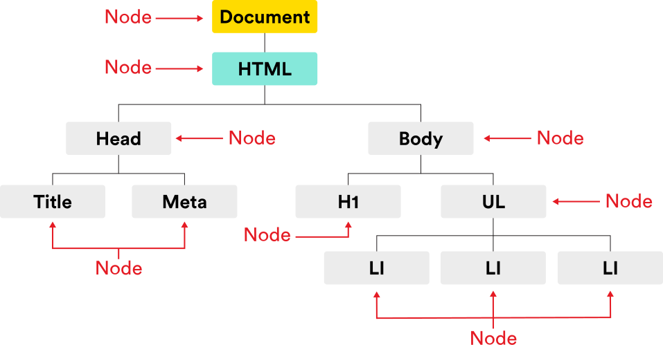
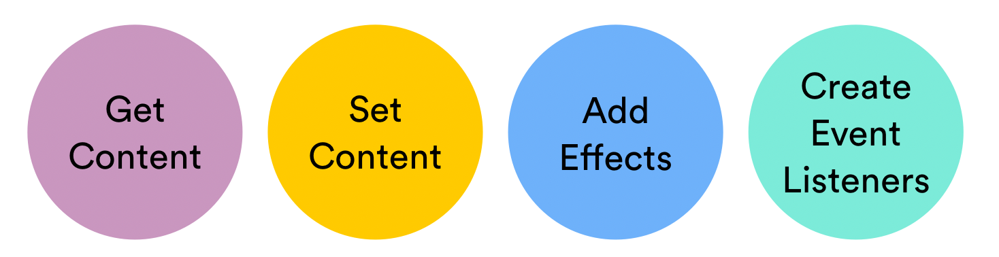
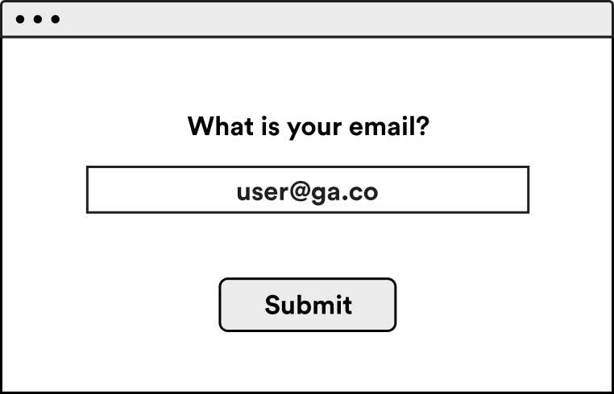
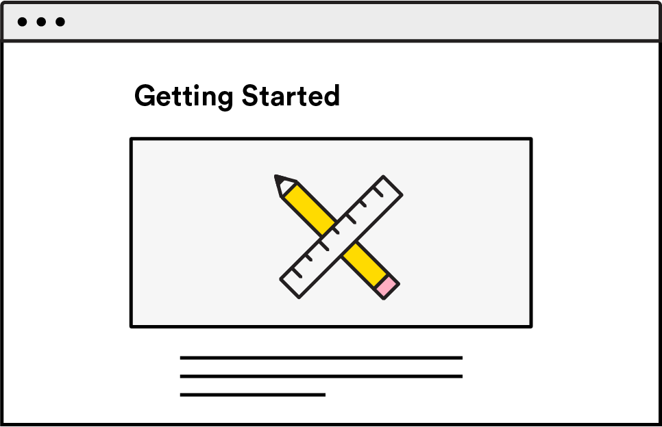
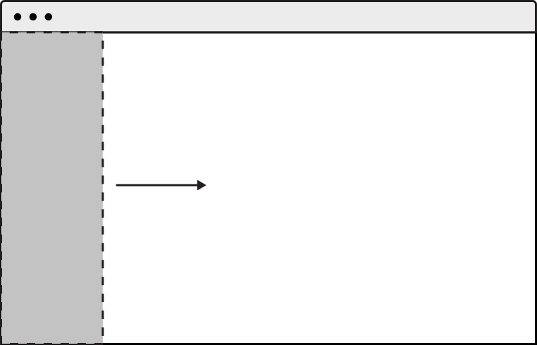
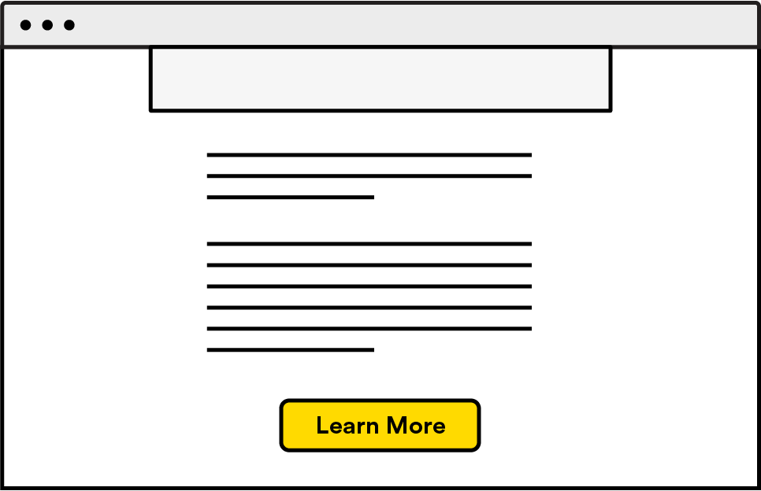
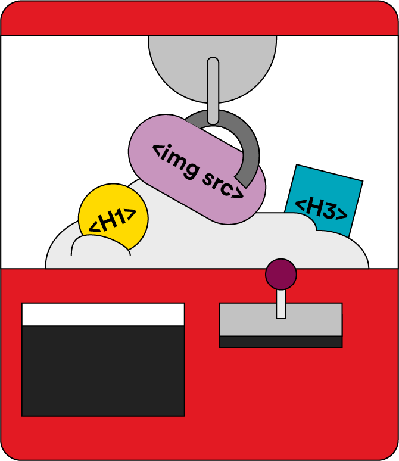

<textarea id="source">

<h1 class="slide-header">Meet the DOM</h1>

<span id=time-estimate class="color-grey-500">60 mins</span>

<p id="lesson-description">
It’s now time to tie together our HTML, CSS, and JavaScript knowledge by using the Document Object Model (DOM) to manipulate a webpage. Most of the real-time interactions you see on a webpage are made possible by the DOM. Let’s make some magic!
</p>

<h5 id="topics-header" class="color-grey-500">Topics</h5>

What is the DOM?

<hr>

Accessing Elements in the DOM

<hr>

Adding Elements Using the DOM

<hr>

<a href="./assets/meet_the_dom_study_guide.pdf" target="_blank" download="meet_the_dom_study_guide.pdf" class="ant-btn" data-trackable="true" data-track-category="study guide" data-track-section="lesson page" data-track-action="download study guide"><span role="img" class="anticon"><svg viewBox="0 0 16 16" width="1em" height="1em" fill="currentColor" aria-hidden="true" focusable="false" class=""><g class="download_svg__nc-icon-wrapper"><path d="M8 12c.3 0 .5-.1.7-.3L14.4 6 13 4.6l-4 4V0H7v8.6l-4-4L1.6 6l5.7 5.7c.2.2.4.3.7.3z"></path><path data-color="color-2" d="M1 14h14v2H1z"></path></g></svg></span><span> Download Study Guide</span></a>

---

<h1 class="slide-header">Learning Objectives</h1>

<p>By the end of this lesson, you'll be able to:</p>

<ul>
  <li>Explain how the DOM works.</li>
  <li>Find and read information from HTML elements using JavaScript.</li>
  <li>Update or remove HTML elements from the webpage.</li>
  <li>Create and add new HTML elements to the webpage.</li>
</ul>

---

<h1 class="slide-header">Intro to the DOM</h1>

The DOM, or **Document Object Model**, is a way for JavaScript to interact with and change HTML elements on a webpage. It allows us to adjust the page’s structure, style, and content.

Let’s break down what the DOM means:

- **Document:** This refers to the webpage itself, usually represented by the HTML document.
- **Object:** Every HTML element (like `<head>`, `<body>`, or `<p>`) is treated as an object. Because these elements are objects, we can use special commands (called methods and properties) to change them, remove them, or add new elements.
- **Model:** The model is how all these objects are arranged in a structured, tree-like format called the **DOM tree**. You might hear the terms “node,” “object,” and “element” — all of these are used to describe parts of the DOM.



---

<h1 class="slide-header">What Does the DOM Do?</h1>

The DOM is what makes websites interactive. It powers many of the actions you see on webpages every day.

The DOM allows you to:

- **Access elements** on the page
- **Read and change content**
- **Change styles and structure**
- **Respond to user interactions**



In this lesson, we will focus on how to **get** and **set** content using the DOM. In the next lesson, we’ll explore how to make pages interactive using event listeners.

---

<h1 class="slide-header">Getting Content from the DOM</h1>

The DOM allows you to **access elements and content** from a webpage.

Why is this useful?

- You can find out what information a user has entered into a form.
- You can access values like email addresses, names, or other input fields and use them in your program.

This is an essential step when building interactive websites that respond to user input.



---

<h1 class="slide-header">Set Content</h1>

The DOM also allows you to **set or change content** on the page.

- You can dynamically update the text, images, or attributes of HTML elements.
- For example, you might want to change the text inside an `<h1>` tag or update the `src` attribute of an image when a user clicks a button.
- This helps make your webpage dynamic and responsive to changes.



---

<h1 class="slide-header">Adding Effects</h1>

The DOM allows you to add **visual effects and animations** to your webpage.

- You can make dropdown menus expand when clicked.
- You can show a “Success” message that fades in after a form is submitted.
- You can have images appear or fade out as the user scrolls.

All of these dynamic effects are possible with JavaScript and the DOM.



---

<h1 class="slide-header">Create Event Listeners</h1>

The DOM allows you to create **event listeners** that respond to user actions.

- A webpage should react to what the user does, not just stay static.
- With event listeners, JavaScript can “listen” for actions like clicks, key presses, or mouse movements, and then run code in response.
- For example, you can make a button change color after the user clicks it by adding an event listener to that button.



---

<h1 class="slide-header">Manipulating the DOM</h1>

To make interactive webpages, developers use **DOM manipulation** — changing, adding, or removing content from the webpage using JavaScript.

At a high level, DOM manipulation happens in two steps:

1. **Find and select** the HTML element you want to work with.
2. **Manipulate** it by accessing, updating, or removing it.

Think of the DOM like a claw or crane machine. Before you can change something, you have to reach in and grab the right piece. Once you’ve got it, you can do what you want with it.

Let’s start by learning how to find elements.



---

<h1 class="slide-header">Finding DOM Elements</h1>

The first step in working with the DOM is telling JavaScript **which element** you want to work with. Since HTML and JavaScript don’t talk to each other directly, you need to use **DOM methods** to select the right element. This is often called "grabbing" an element.

Here are two simple methods we’ll use to select DOM elements:

- `document.querySelector()`: Finds **the first** matching element.
- `document.querySelectorAll()`: Finds **all** matching elements.

The word `document` tells JavaScript to look at the HTML page. The details of what you’re looking for go inside the parentheses.

`document.querySelector()` and `document.querySelectorAll()` find DOM elements using a format that should be familiar: **CSS selector syntax**.

We’ll go over how to write those selectors next.

---

<h1 class="slide-header">Knowledge Check</h1>

We’ll be using CSS selectors in the next section, so let’s do a quick review.

Which of the following statements about CSS selectors are **true**?

<fieldset>
    <legend>Please select all that apply</legend>
<input type='checkbox' id='answer1' value='answer1' /><label for='answer1'><code>#</code> indicates a class</label><br />
<input type='checkbox' id='answer2' value='answer2' correct='true' /><label for='answer2'><code>.</code> indicates a class</label><br />
<input type='checkbox' id='answer3' value='answer3' correct='true' /><label for='answer3'><code>#</code> indicates an ID</label><br />
<input type='checkbox' id='answer4' value='answer4' /><label for='answer4'><code>.</code> indicates an ID</label><br />
</fieldset>
<button class='ant-btn ant-btn-primary multiple-choice-radio-submit'>Submit Answer</button>

---

<h1 class="slide-header">Query Selectors</h1>

Here’s how we use query selector methods to find elements in the DOM:

| Example                              | What It Does                                                            |
| ------------------------------------ | ----------------------------------------------------------------------- |
| `document.querySelector('p')`        | Selects the **first** `<p>` element in the document.                    |
| `document.querySelector('.magic')`   | Selects the **first** element with the class `"magic"`.                 |
| `document.querySelector('#hero')`    | Selects the **first** element with the ID `"hero"`.                     |
| `document.querySelector('.magic p')` | Selects the **first** `<p>` inside an element with the class `"magic"`. |


<br>

The method `document.querySelectorAll()` works similarly, but instead of just one element, it will select **all** elements that match the query.

---

<h1 class="slide-header">Knowledge Check</h1>

Take a look at the following code snippet. How would we grab the element with the class `complete`?

```html
<h2>To-Do List</h2>
<ul>
  <li id="special">Water the plants.</li>
  <li class="complete">Send an email.</li>
  <li>Read a book.</li>
</ul>
```

<fieldset>
    <legend>Please select one of the following</legend>
<input type='radio' name='answers' id='answer1' value='answer1' /><label for='answer1'><code>document.querySelector(complete);</code></label><br />
<input type='radio' name='answers' id='answer2' value='answer2' /><label for='answer2'><code>querySelector('.complete');</code></label><br />
<input type='radio' name='answers' id='answer3' value='answer3' /><label for='answer3'><code>document.querySelector = '.complete';</code></label><br />
<input type='radio' name='answers' id='answer4' value='answer4' correct='true' /><label for='answer4'><code>document.querySelector('.complete');</code></label><br />
</fieldset>
<button class='ant-btn ant-btn-primary multiple-choice-radio-submit'>Submit Answer</button>

---

<h1 class="slide-header">QuerySelector Practice</h1>

Let’s practice using `querySelector()`!

For this exercise you will need to view both the HTML and Javascript sections of the CodePen.

**1. Look at each `querySelector()` method and fill in the correct arguments to select the requested HTML elements.**  
**2. Use CSS selector syntax inside the parentheses.**  
**3. We’ve included `console.log()` statements to help you check if you’ve selected the correct elements.**

Take your time and make sure you’re using the right selectors!

<iframe sandbox="allow-scripts allow-top-navigation allow-top-navigation-by-user-activation allow-forms allow-popups allow-same-origin"  height="400" style="width: 100%;" scrolling="no" title="QuerySelector Practice" src="https://codepen.io/GAmarketing/embed/zYXombN?default-tab=js%2Cresult&editable=true" frameborder="no" loading="lazy" allowtransparency="true" allowfullscreen="true">
  See the Pen <a href="https://codepen.io/GAmarketing/pen/zYXombN">
  QuerySelector Practice</a> by General Assembly (<a href="https://codepen.io/GAmarketing">@GAmarketing</a>)
  on <a href="https://codepen.io">CodePen</a>.
</iframe>

---

<h1 class="slide-header">Manipulating the DOM</h1>

Once you’ve selected an element from the DOM, you can **access, update, and change** its content, styles, and structure.

There are many things you can do with a DOM element. Here are some of the most common properties and how they are used:

| Property Name        | What It Does                                                   | Example                                                                                                   |
| -------------------- | -------------------------------------------------------------- | --------------------------------------------------------------------------------------------------------- |
| `element.innerHTML`  | Gets or sets the HTML content inside the element.              | `document.querySelector('h2').innerHTML = 'Hello there!';` updates the `<h2>` text to say "Hello there!". |
| `element.style`      | Allows you to change the CSS styles of the element.            | `document.querySelector('h2').style.color = 'blue';` changes the `<h2>` color to blue.                    |
| `element.className`  | Sets or changes the class name of the element.                 | `document.querySelector('h2').className = 'complete';` sets the `<h2>` class to `complete`.               |
| `element.parentNode` | Returns the parent element that contains the selected element. | `document.querySelector('h2').parentNode;` returns the parent element of the `<h2>`.                      |
| `element.childNodes` | Returns a list of all child nodes inside the selected element. | `document.querySelector('h2').childNodes;` returns any child nodes inside the `<h2>`.                     |

<br>

We’ll use these properties often to make pages dynamic and responsive to user interactions.

---

<h1 class="slide-header">Example: Updating HTML Content</h1>

Let’s look at an example of how to change the content of an HTML element using the DOM.

Given this HTML:

```html
<h1>Visit my site</h1>
```

We want to update it so it looks like this:

```html
<h1>Visit my <a href="http://www.coolsite.net">site</a></h1>
```

To do this with JavaScript, we can use the `innerHTML` property to replace the entire content of the `<h1>`:

```javascript
document.querySelector('h1').innerHTML = 'Visit my <a href="http://www.coolsite.net">site</a>';
```

This shows how you can use `innerHTML` to dynamically update elements with new content and even new HTML tags.

---

<h1 class="slide-header">Getting, Setting, and Removing Attributes</h1>

In addition to changing content and styles, you can also **get, update, or remove attributes** from DOM elements using special methods.

Remember : An **attribute** is extra information inside an HTML tag that describes or defines something about the element. Examples include `id`, `class`, `href`, or `src`.

These methods let you read or modify any attribute in your HTML:

- **`getAttribute()`** — retrieves the value of an attribute.
- **`setAttribute()`** — sets or updates the value of an attribute.
- **`removeAttribute()`** — removes an attribute from an element.

Let’s look at some examples:

```javascript
const h1ID = document.querySelector('h1').getAttribute('id');
// This stores the ID attribute of the <h1> element in a variable called h1ID.

document.querySelector('#title').setAttribute('class', 'blue');
// This sets the element with the ID "title" to have a class of "blue."

const paragraphs = document.querySelectorAll('p');
paragraphs.forEach((p) => p.removeAttribute('class'));
// This removes the class attribute from all <p> elements.
```

> Note: When using `removeAttribute()`, if you're working with multiple elements (like all `<p>` tags), you’ll need to loop through them to remove the attribute from each one.

---

<h1 class="slide-header">Example: Adding a Class to an Element</h1>

Let’s look at how to add a class to an element using the DOM.

Given this HTML:

```html
<h1>Welcome to our store</h1>
<div class="advertisement">
  <h2>BUY BUY BUY</h2>
  <p>Only 30 days left in our monthly sale. Move fast!</p>
</div>
```

We want to add the class `urgent` to the `<h2>` element.

There are two ways to do this:

**Option 1 — Using `className`:**

```javascript
document.querySelector('h2').className = 'urgent';
```

**Option 2 — Using `setAttribute()`:**

```javascript
document.querySelector('h2').setAttribute('class', 'urgent');
```

Both methods will add the class, and you would see the `<h2>` element updated in the DOM with `class="urgent"`.

---

<h1 class="slide-header">Creating DOM Elements</h1>

The DOM doesn’t just let you access or change existing elements — you can also **create new elements** from scratch using JavaScript.

To create a new element, use:

```javascript
document.createElement(tagName);
```

Here’s an example of creating a new paragraph element and customizing it:

```javascript
const paragraph = document.createElement('p');
paragraph.innerText = 'Your passwords did not match.';
paragraph.setAttribute('class', 'registration-error');

// This will create:
// <p class="registration-error">Your passwords did not match.</p>
```

---

<h1 class="slide-header">Breaking Down the Steps</h1>

Let’s walk through what’s happening in that example:

```javascript
const paragraph = document.createElement('p');
paragraph.innerText = 'Your passwords did not match.';
paragraph.setAttribute('class', 'registration-error');

// This will create: <p class="registration-error">Your passwords did not match.</p>
```

1. Create a variable called `paragraph`.
2. Use `document.createElement('p')` to create a new `<p>` element and assign it to the `paragraph` variable. Right now, the paragraph exists in JavaScript but has no content yet.
3. Use the `innerText` property to add the message: `"Your passwords did not match."`
4. Use `setAttribute()` to give the paragraph a class of `registration-error`.

Notice that we’re using `innerText` and `setAttribute()` on the `paragraph` variable. In JavaScript, this variable represents the new element, and everything you add to it will eventually appear in the HTML when it’s added to the page.

---

<h1 class="slide-header">Adding Elements to the DOM</h1>

Once you’ve created a new element, it won’t automatically show up on the page. You need to **add it to the DOM** using one of these methods:

| Method                                                | What It Does                                                                   |
| ----------------------------------------------------- | ------------------------------------------------------------------------------ |
| `element.append(newElement)`                          | Adds the `newElement` as the last child (at the end) of the selected `element` |
| `element.prepend(newElement)`                         | Adds the `newElement` as the first child (at the beginning) of the `element`   |
| `element.insertAdjacentElement(position, newElement)` | Adds the `newElement` at a specific position relative to the `element`         |

<br>

**Example: Adding a new paragraph to a `<div id="posts">`**

```javascript
// First, create the new element and store it in a variable
const newPost = document.createElement('p');

// Set the content of the new element
newPost.innerText = 'JavaScript can be tough!';

// Find the parent element you want to add the new element to
const postsDiv = document.querySelector('#posts');

// Add the new element to the end of the postsDiv
postsDiv.append(newPost);
```

This process allows you to create and display new content dynamically on your webpage.

---

<h1 class="slide-header">Your Turn</h1>

Now it’s time to practice DOM manipulation with the challenges in the next few slides.

These exercises might feel challenging — and that’s okay! Learning to code means thinking in new ways and being comfortable working through struggles. In fact, one of the most important skills for a programmer is learning how to problem-solve and keep going when things get tough.

Another key skill is knowing how to look up information when you need it. (Professional developers do this every day!) If you get stuck or are unsure about how something works, use <a href="https://www.w3schools.com/jsref/dom_obj_all.asp" target="_blank" rel="noreferrer noopener">this list of DOM properties and methods</a> to help you find the answers.

Keep going — each challenge is building your skills!

---

<h1 class="slide-header">Accessing Elements and Element Properties</h1>

For this exercise you will need to view both the HTML and Javascript sections of the CodePen.

**1. Select the element with the ID of `title` and store it in a variable called `titleElement`.**  
**2. Get the text content from `titleElement` and store it in a variable named `titleText`.**

This will help you practice selecting elements and reading their properties.

<iframe sandbox="allow-scripts allow-top-navigation allow-top-navigation-by-user-activation allow-forms allow-popups allow-same-origin"  height="400" style="width: 100%;" scrolling="no" title="Accessing Elements" src="https://codepen.io/GAmarketing/embed/xxeRyBr?default-tab=js%2Cresult&editable=true" frameborder="no" loading="lazy" allowtransparency="true" allowfullscreen="true">
  See the Pen <a href="https://codepen.io/GAmarketing/pen/xxeRyBr">
  Accessing Elements</a> by General Assembly (<a href="https://codepen.io/GAmarketing">@GAmarketing</a>)
  on <a href="https://codepen.io">CodePen</a>.
</iframe>

---

<h1 class="slide-header">Accessing Element Attributes</h1>

For this exercise you will need to view both the HTML and Javascript sections of the CodePen.

**1. Select the first `span` element on the page.**  
**2. Get the value of its `class` attribute and store it in a variable called `spanClass`.**

<iframe sandbox="allow-scripts allow-top-navigation allow-top-navigation-by-user-activation allow-forms allow-popups allow-same-origin" height="400" style="width: 100%;" scrolling="no" title="Accessing Attributes" src="https://codepen.io/GAmarketing/embed/oNOYaVp?default-tab=js%2Cresult&editable=true" frameborder="no" loading="lazy" allowtransparency="true" allowfullscreen="true">
  See the Pen <a href="https://codepen.io/GAmarketing/pen/oNOYaVp">
  Accessing Attributes</a> by General Assembly (<a href="https://codepen.io/GAmarketing">@GAmarketing</a>)
  on <a href="https://codepen.io">CodePen</a>.
</iframe>
	
---

<h1 class="slide-header">Updating Elements</h1>

For this exercise you will need to view both the HTML and Javascript sections of the CodePen.

**1. Select the first element on the page.**  
**2. Add the class `blue` to that element to change its text color.**

<iframe sandbox="allow-scripts allow-top-navigation allow-top-navigation-by-user-activation allow-forms allow-popups allow-same-origin"  height="400" style="width: 100%;" scrolling="no" title="Updating the Blue Span" src="https://codepen.io/GAmarketing/embed/YzMpJgL?default-tab=js%2Cresult&editable=true" frameborder="no" loading="lazy" allowtransparency="true" allowfullscreen="true">
  See the Pen <a href="https://codepen.io/GAmarketing/pen/YzMpJgL">
  Updating the Blue Span</a> by General Assembly (<a href="https://codepen.io/GAmarketing">@GAmarketing</a>)
  on <a href="https://codepen.io">CodePen</a>.
</iframe>

---

<h1 class="slide-header">Updating Elements</h1>

For this exercise you will need to view both the HTML and Javascript sections of the CodePen.

**1. Select the `h1` element with the ID of `title`.**  
**2. Change its text to say `Javascript is great!`.**

<iframe sandbox="allow-scripts allow-top-navigation allow-top-navigation-by-user-activation allow-forms allow-popups allow-same-origin"  height="400" style="width: 100%;" scrolling="no" title="Welcome to the DOM" src="https://codepen.io/GAmarketing/embed/gOyLBEQ?default-tab=js%2Cresult&editable=true" frameborder="no" loading="lazy" allowtransparency="true" allowfullscreen="true">
  See the Pen <a href="https://codepen.io/GAmarketing/pen/gOyLBEQ">
  Welcome to the DOM</a> by General Assembly (<a href="https://codepen.io/GAmarketing">@GAmarketing</a>)
  on <a href="https://codepen.io">CodePen</a>.
</iframe>

---

<h1 class="slide-header">Creating Elements</h1>

For this exercise you will need to view both the HTML and Javascript sections of the CodePen.

**1. Create a new `h4` element.**  
**2. Set the text of the `h4` element to `Powered by JavaScript`.**  
**3. Add the new `h4` element to the end of the `<body>` of the page.**

  <iframe sandbox="allow-scripts allow-top-navigation allow-top-navigation-by-user-activation allow-forms allow-popups allow-same-origin"  height="400" style="width: 100%;" scrolling="no" title="Creating Elements" src="https://codepen.io/GAmarketing/embed/OJGbBqd?default-tab=js%2Cresult&editable=true" frameborder="no" loading="lazy" allowtransparency="true" allowfullscreen="true">
    See the Pen <a href="https://codepen.io/GAmarketing/pen/OJGbBqd">
    Creating Elements</a> by General Assembly (<a href="https://codepen.io/GAmarketing">@GAmarketing</a>)
    on <a href="https://codepen.io">CodePen</a>.
  </iframe>

---

<h1 class="slide-header">Removing Elements</h1>

For this exercise you will need to view both the HTML and Javascript sections of the CodePen.

**1. Select the `h1` element with the ID of `title`.**  
**2. Remove the selected element from the page using the `remove()` method.**  
**3. If you need help, use the <a href="https://developer.mozilla.org/en-US/docs/Web/API/ChildNode/remove" target="_blank" rel="noreferrer noopener">MDN documentation</a> for reference.**

<iframe sandbox="allow-scripts allow-top-navigation allow-top-navigation-by-user-activation allow-forms allow-popups allow-same-origin"  height="400" style="width: 100%;" scrolling="no" title="Removing Elements" src="https://codepen.io/GAmarketing/embed/wvZoYOZ?default-tab=js%2Cresult&editable=true" frameborder="no" loading="lazy" allowtransparency="true" allowfullscreen="true">
  See the Pen <a href="https://codepen.io/GAmarketing/pen/wvZoYOZ">
  Removing Elements</a> by General Assembly (<a href="https://codepen.io/GAmarketing">@GAmarketing</a>)
  on <a href="https://codepen.io">CodePen</a>.
</iframe>

---

<h1 class="slide-header">Conclusion</h1>

DOM manipulation is what transforms simple JavaScript console programs into **dynamic, interactive web pages** with user-friendly interfaces.

The next step is learning how to add **event listeners**, so users can interact with your page by clicking buttons, submitting forms, and performing other common actions. This allows your well-planned DOM manipulations to respond directly to user input, making your applications feel alive and engaging.

</textarea>
